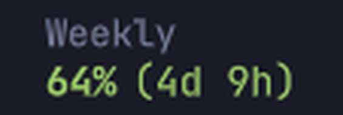
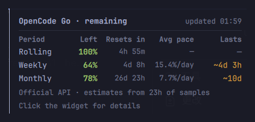
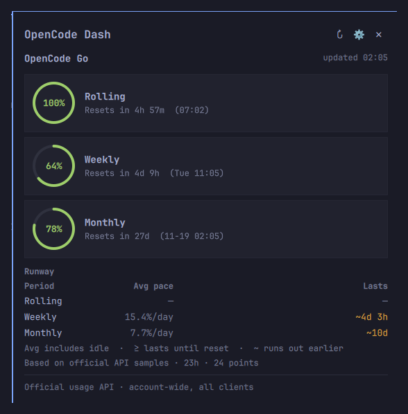
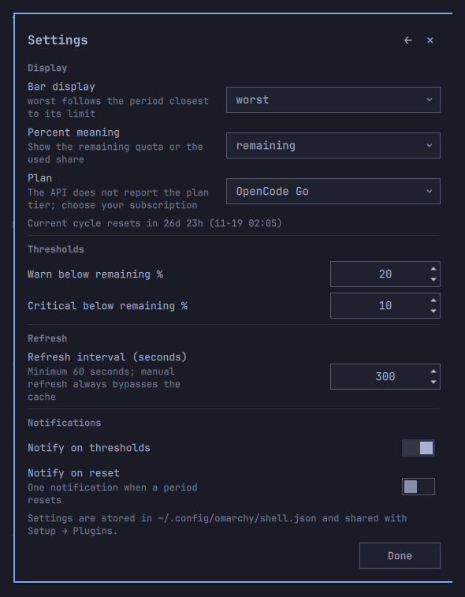

# OpenCode Dash

[UI](#ui) · [English](#english) · [中文](#中文)

## UI

**Bar · 顶栏** — always visible; `worst` and `month` show the period and reset countdown on two lines. / 始终可见；`worst` / `month` 分两行显示周期和重置倒计时。


**Tooltip · 悬停提示** — hover for all periods, reset countdowns, and runway. / 悬停查看三个周期、重置倒计时和 runway。


**Panel · 面板** — click for quota cards, reset times, and runway. / 点击查看额度卡片、重置时间和 runway。


**Settings · 设置** — gear in the panel or right-click the widget. / 面板齿轮或右键打开。


## English

OpenCode Dash is an Omarchy bar widget for the **OpenCode Go / Go Plus**
subscription. It reads the official usage endpoint, so the percentages include
**every client** that uses the subscription — the OpenCode CLI/TUI, ZCode, and
any future agent.

### Features

- Bar display: `worst` (least remaining), `all` periods, or `month` only.
- In `worst` / `month` modes the bar shows the period on its own line and the
  percentage + reset countdown below it; `all` mode stays on one line.
- Remaining percentage by default; switch to used in the settings.
- Status colors (defaults): healthy green, remaining ≤ 20% amber, ≤ 10% red
  with `!`. In single-period modes the percentage and reset countdown share the
  status color; the period label stays dim.
- Panel: three quota periods, reset times/countdowns, and a Runway table
  (`Period · Avg pace · Lasts`) projecting how long the current rate can last.
- Threshold notifications through `notify-send`, deduplicated per period,
  level, and reset time.
- Settings in the panel and in Setup → Plugins edit the same `shell.json`
  fields.
- Light and dark themes; top, bottom, left, and right bars.
- Official account-level data only; no local agent logs, no model/cost
  estimates, no telemetry.

### How the three layers work

| Layer | Interaction | What it shows | Purpose |
|---|---|---|---|
| Bar | always visible | the selected bar view (`worst`, `all`, or `month`) with reset countdowns | notice at a glance |
| Tooltip | hover | three periods, reset countdowns, and runway estimates | a 3-second check |
| Panel | click | the same facts + context + controls | inspect and adjust |

The tooltip is a read-only preview of the same `report` the panel uses, so the
numbers cannot diverge. New details and controls belong in the panel first; a
feature moves into the tooltip only when it is essential for a quick check and
fits on one screen.

### Requirements

- Omarchy Quattro 4.x (tested on 4.0.6).
- Python 3.10 or newer (standard library only).
- `notify-send` from libnotify, for notifications (optional).
- OpenCode signed in to OpenCode Go or Go Plus.

### Install

```bash
omarchy plugin add https://github.com/jihonghe/opencode-dash --enable
omarchy restart shell
```

If the widget is installed but not in the bar yet:

```bash
omarchy plugin enable jihonghe.opencode-dash
```

Move it with `omarchy bar move jihonghe.opencode-dash --section right`, or
drag it in the bar. Update and remove with:

```bash
omarchy plugin update jihonghe.opencode-dash
omarchy plugin remove jihonghe.opencode-dash
```

Removing the plugin leaves cached samples in `~/.cache/opencode-dash/`; delete
that directory if you want a completely clean removal.

### First run

The plugin never asks for an API key. It reuses the credential that OpenCode
already stores.

1. Sign in to OpenCode Go:

   ```bash
   opencode auth login
   ```

   Choose **OpenCode Go** and finish the browser/device flow.

2. Verify the credential:

   ```bash
   opencode auth list
   ```

   It should show `OpenCode Go ... stored`.

3. Restart the shell:

   ```bash
   omarchy restart shell
   ```

4. Select your plan in **Settings → Plan** (`OpenCode Go` or
   `OpenCode Go Plus`). This is a display label only; the API does not report
   the plan tier.

5. If `opencode.ai` is reachable only through a proxy, export `https_proxy` in
   the environment that starts `omarchy-shell`. The plugin honors standard
   proxy variables; it does not configure one itself.

Do not copy the key from `opencode.db` into the plugin. The plugin reads the
credential read-only and never stores or logs it.

### Configuration

Settings live inline in `~/.config/omarchy/shell.json` under this widget's
layout entry. The panel's settings page and **Setup → Plugins** edit the same
fields.

| Key | Type | Default | Description |
|---|---|---|---|
| `refreshIntervalSec` | integer | `300` | Refresh interval, 60–3600 seconds |
| `barWindows` | enum | `worst` | `worst`, `all`, or `month`; horizontal bar only (vertical always shows the worst period) |
| `percentMode` | enum | `remaining` | `remaining` or `used` |
| `warnRemaining` | integer | `20` | Warn below this remaining percentage |
| `critRemaining` | integer | `10` | Critical below this remaining percentage |
| `notifyEnabled` | boolean | `true` | Threshold notifications |
| `notifyReset` | boolean | `false` | Notify when a period resets |
| `planLabel` | enum | `OpenCode Go` | `OpenCode Go` or `OpenCode Go Plus`; display label only |

The bar uses the official period names: `Rolling`, `Weekly`, and `Monthly`.
In `worst` and `month` modes a horizontal bar shows the period name on its own
line, with the percentage and the reset countdown in parentheses below it
(`Weekly` / `80% (5d 12h)`). `all` mode stays on one line. In a vertical bar it
uses the short aliases `5h`, `7d`, and `M`, with the worst period on two lines
(`7d` / `79%`), to stay readable; `barWindows` only affects the horizontal
layout.

OpenCode subscription plans are **OpenCode Go** and **OpenCode Go Plus**.
**Zen is not a subscription tier**; it is OpenCode's pay-as-you-go console/API
platform. The API does not report which subscription tier is active, so the
settings dropdown is a fixed choice; it only changes the display label. The
settings page also shows the current cycle reset countdown from the official
`monthly.resetsAt`.

### Runway

The official endpoint only returns the **current** percentages. Runway is built
from samples the plugin records each time it refreshes. It is a single,
wall-clock estimate per period:

- **Avg pace** is the least-squares trend over all samples in the current
  period. It uses wall-clock time, so idle periods count towards the average.
  This is deliberately conservative: it answers "at my overall pace, how long
  will the remaining quota last?"
- At least **3 samples** spanning **1 hour** are required, and the latest
  sample must be fresh (`≤ max(15 min, 2 × refresh interval)`). Until then, the
  `Avg pace` cell shows `Collecting` and `Lasts` shows `—` (the official columns
  stay visible); the estimate appears automatically after the first hour.
- A period without a positive numeric rate shows `—` in both `Avg pace` and
  `Lasts` (idle, flat, draining, or unavailable). No duration is shown without
  a rate. The Runway section is hidden when no period has a numeric rate and
  none is collecting.
- Duration labels: `≥ 4h 18m` means the rate lasts at least until reset (the
  same countdown as `Resets in`); `~3d 8h` means it runs out before reset;
  `0m` means the period is empty.
- The panel's Runway footer shows the sample basis, e.g.
  `Based on official API samples · 5h 10m · 106 points`; the tooltip footer
  shows the same span as `estimates from ... of samples`.
- Colors apply to the projected duration:
  - **Green**: remaining is healthy and the rate lasts until reset.
  - **Amber**: remaining is at or below the warn threshold, or the rate
    exhausts the period before reset.
  - **Red**: remaining is at or below the critical threshold, or the period is
    empty.
- The percentage color reflects **current remaining**; the Runway color
  reflects the **forecast**. They can differ: a green percentage with an amber
  runway means there is still quota, but the current rate will use it before
  the period resets.
- A flat or idle period shows `—` in both derived columns; it never shows
  `0.0%/h`. The official percentage and reset time remain visible above.
- In the tooltip, `Resets in` shows only the countdown (`2m`, `5d 2h`); the
  panel shows `Resets in <countdown> (<absolute time>)`. The tooltip shows the
  same `Avg pace` and `Lasts` columns, and the footer shows the sample span.
- The Runway table legend: `Avg includes idle · ≥ lasts until reset ·
  ~ runs out earlier`.

There is intentionally no "active-only" estimate. It divides usage by the time
spent in short active intervals, then extrapolates that rate across wall-clock
time. With integer percentages sampled every few minutes, a single `+1%` tick
can dominate the result and produce alarming projections such as `~4h`, even
when the overall pace would last until reset.

### Data sources and privacy

- Quota percentages come from
  `GET https://opencode.ai/zen/go/v1/usage` with a Bearer token. This endpoint
  is official but not documented; other OpenCode tools use it as well.
- The key is read from the v2 `credential` table in
  `~/.local/share/opencode/opencode.db` (`integration_id = 'opencode-go'`), with
  `~/.local/share/opencode/auth.json` as the v1 fallback.
- The database is opened with `mode=ro`, and only the `credential` table is
  read. No session, message, model, or cost data is read from OpenCode.
- The key is kept in memory only. It is never written to a file, cache, log,
  command line, or error message. The only host that receives it is
  `opencode.ai`.
- The request refuses HTTP redirects and caps the response body at 1 MiB, so
  the key cannot follow a redirect and a broken endpoint cannot grow the
  helper without bound.
- Cache files live in `~/.cache/opencode-dash/` (directory `0700`, files
  `0600`) and contain percentages, timestamps, API samples, and local alert
  bookkeeping only.
- Standard `https_proxy` / `HTTPS_PROXY` environment variables are honored;
  no proxy is configured by the plugin itself.
- No telemetry and no other network destinations.

### How it works

`BarWidget.qml` periodically runs `python3 scripts/dash.py --json`. The
script reads the key, calls the usage endpoint, appends a sample, computes
runway, and returns one JSON document. QML only renders it. A 60-second cache
and a file lock keep multiple bar instances from duplicating API calls; manual
refresh (`middle click`, the panel button, or `r` in the panel) bypasses the
cache. Notifications are sent with `notify-send`; no systemd unit is installed.

### Troubleshooting

- **Bar shows `—`**: run `opencode auth list`. If it is missing, run
  `opencode auth login` and choose OpenCode Go, then `omarchy restart shell`.
  An expired credential is fixed the same way.
- **Values look stale**: the API is unreachable; the last successful reading
  is shown dimmed. The panel shows a stale notice and the last update time; the
  tooltip adds a `cached at` line.
- **`Avg pace` says `Collecting`**: there are samples, but not yet 3 points
  over 1 hour (or the period just reset). Official values stay visible; the
  estimate appears automatically. The Runway table is hidden when the latest
  sample is stale or when no period has a numeric rate and none is collecting.
- **No notifications**: check `notify-send`, your notification daemon, and
  Do Not Disturb. Alerts are deduplicated per period/level/reset.
- **Check the data layer manually**:
  `python3 scripts/dash.py --json --force --debug | python3 -m json.tool`
- **QML warnings**: `journalctl --user -b --no-pager | grep -i opencode-dash`
- After installing or updating, run `omarchy restart shell` once.

### Development

```bash
# Link the working tree instead of cloning
ln -sfn "$PWD" ~/.config/omarchy/plugins/jihonghe.opencode-dash
omarchy-shell shell rescanPlugins
omarchy plugin enable jihonghe.opencode-dash

# Tests (no network or real key required)
python3 -m unittest discover -s tests -v
tests/run-model-test.sh

# Manifest check
omarchy plugin validate .
```

For UI state tests, add `"debugFixture": "/path/to/tests/fixtures/report-stale.json"`
to the widget's `shell.json` entry. The script then returns that fixture
instead of real data. Available fixtures: `report-stale.json`,
`report-no-key.json`, `report-auth-expired.json`, `report-not-ready.json`
(insufficient samples: `Collecting` / `—`), `report-idle.json` (flat period:
both derived cells `—`), and `report-preview.json` (deterministic 100/64/78
values with weekly/monthly runway for README screenshots).
Remove the setting when done.

### Credits and license

- Settings persistence follows the pattern from
  [crmne/omastats](https://github.com/crmne/omastats) (MIT).
- Endpoint behavior and UX were informed by
  [slkiser/opencode-quota](https://github.com/slkiser/opencode-quota),
  [mryll/claudebar](https://github.com/mryll/claudebar), and
  [othavi0/omarchy-agent-bar](https://github.com/othavi0/omarchy-agent-bar).
- Licensed under the MIT License; see [LICENSE](LICENSE).

---

## 中文

OpenCode Dash 是一个显示 **OpenCode Go / Go Plus** 订阅额度的 Omarchy 顶栏插件。
它直接读取官方 usage 端点，所以百分比覆盖**所有使用该订阅的客户端**——OpenCode
CLI/TUI、ZCode，以及未来任何 Agent。

### 功能

- 顶栏显示：`worst`（剩余最少）、`all`（三个周期）、`month`（只看订阅月）。
- `worst` / `month` 模式下，顶栏分两行显示周期名和“百分比 + 重置倒计时”；`all` 模式保持单行。
- 默认显示剩余百分比，可在设置里切换为已用。
- 状态颜色（默认）：健康绿色、剩余 ≤ 20% 琥珀色、≤ 10% 红色并带 `!`。单周期模式下
  百分比和重置倒计时共用状态色，周期标签用暗色。
- 面板：三个额度周期、重置时间和倒计时，以及 `Period · Avg pace · Lasts` 的
  Runway 表，按当前速度预估还能用多久。
- 阈值通知由 `notify-send` 发送；按“周期 + 级别 + 重置时间”去重。
- 面板设置页和 Setup → Plugins 修改同一份 `shell.json` 字段。
- 明暗主题、top/bottom/left/right 四个方向的顶栏。
- 只使用官方账号级数据；不读本地 Agent 日志，不做模型/cost 估算，无遥测。

### 三层信息

| 层级 | 交互 | 显示内容 | 目的 |
|---|---|---|---|
| 顶栏 | 始终可见 | 当前顶栏视图（`worst` / `all` / `month`）和重置倒计时 | 余光确认 |
| Tooltip | 悬停 | 三个周期、重置倒计时和 runway 估算 | 3 秒快速查看 |
| 面板 | 点击 | 同样的事实 + 上下文 + 操作 | 查看并调整 |

Tooltip 是面板同一份 `report` 的只读预览，数字不会分叉。新的详情和操作优先放面板；
只有“快速查看必需且一屏能放下”的功能才提升到 tooltip。

### 依赖

- Omarchy Quattro 4.x（在 4.0.6 上测试）。
- Python 3.10+（只用标准库）。
- `notify-send`（libnotify），用于通知，可选。
- OpenCode 已登录 OpenCode Go 或 Go Plus。

### 安装

```bash
omarchy plugin add https://github.com/jihonghe/opencode-dash --enable
omarchy restart shell
```

如果插件已安装但没出现在顶栏：

```bash
omarchy plugin enable jihonghe.opencode-dash
```

用 `omarchy bar move jihonghe.opencode-dash --section right` 移动位置，或在顶栏上
直接拖动。更新和卸载：

```bash
omarchy plugin update jihonghe.opencode-dash
omarchy plugin remove jihonghe.opencode-dash
```

卸载插件后，`~/.cache/opencode-dash/` 里的采样缓存会保留；需要彻底清理时手动删除
该目录即可。

### 首次使用

插件不会要求你填写 API key；它直接复用 OpenCode 已经保存的凭据。

1. 登录 OpenCode Go：

   ```bash
   opencode auth login
   ```

   选择 **OpenCode Go**，完成浏览器/设备登录。

2. 验证凭据：

   ```bash
   opencode auth list
   ```

   应显示 `OpenCode Go ... stored`。

3. 重启 shell：

   ```bash
   omarchy restart shell
   ```

4. 在 **Settings → Plan** 选择套餐（`OpenCode Go` 或 `OpenCode Go Plus`）。
   这只影响显示标签；API 不返回套餐类型。

5. 如果只有通过代理才能访问 `opencode.ai`，在启动 `omarchy-shell` 的环境里设置
   `https_proxy`。插件尊重标准代理环境变量，不会自己配置代理。

不要把 `opencode.db` 里的 key 复制到插件里。插件以只读方式读取凭据，不会保存或
记录 key。

### 配置

设置保存在 `~/.config/omarchy/shell.json` 中本 widget 的 layout entry 里。面板设置页
和 **Setup → Plugins** 修改的是同一份字段。

| 键 | 类型 | 默认 | 说明 |
|---|---|---|---|
| `refreshIntervalSec` | integer | `300` | 刷新间隔，60–3600 秒 |
| `barWindows` | enum | `worst` | `worst` / `all` / `month`；仅横向顶栏（垂直顶栏始终显示最紧周期） |
| `percentMode` | enum | `remaining` | `remaining` / `used` |
| `warnRemaining` | integer | `20` | 剩余低于此百分比时警告 |
| `critRemaining` | integer | `10` | 剩余低于此百分比时严重警告 |
| `notifyEnabled` | boolean | `true` | 阈值通知 |
| `notifyReset` | boolean | `false` | 周期重置时通知 |
| `planLabel` | enum | `OpenCode Go` | `OpenCode Go` 或 `OpenCode Go Plus`；仅用于显示 |

顶栏使用官方周期名：`Rolling` / `Weekly` / `Monthly`。在 `worst` / `month` 模式下，
横向顶栏把周期名单独放在一行，下面显示百分比和括号内的重置倒计时，例如
`Weekly` / `80% (5d 12h)`；`all` 模式保持单行。垂直顶栏为节省宽度使用短标签
`5h` / `7d` / `M`，并分两行显示最紧周期（`7d` / `79%`）；`barWindows` 只影响横向布局。

OpenCode 的订阅套餐只有 **OpenCode Go** 和 **OpenCode Go Plus**。**Zen 不是订阅套餐**，
它是 OpenCode 的按量计费 console/API 平台。API 不返回当前套餐类型，所以设置里的下拉框
是固定选项，只影响显示标签；设置页同时显示官方 `monthly.resetsAt` 对应的当前周期重置
倒计时。

### Runway

官方端点只返回**当前**百分比。Runway 来自插件每次刷新时记录的采样，每个周期只给
一个按实际时间计算的估算：

- **Avg pace**：对当前周期内所有采样做最小二乘趋势。使用实际时间（wall clock），
  空闲时间也计入平均。它是保守口径，回答的是“按我的整体节奏，剩余额度还能撑多久”。
- 至少需要 **3 个样本**、跨度至少 **1 小时**，且最新样本不能太旧
  （`≤ max(15 min, 2 × 刷新间隔)`）。在此之前，`Avg pace` 格显示 `Collecting`，
  `Lasts` 显示 `—`，官方列仍然可见；满 1 小时后自动出现估算。
- 没有正速率的周期，`Avg pace` 和 `Lasts` 都显示 `—`（空闲、flat、滑出或不可用）。
  没有正速率时不会显示时长；所有周期都没有正速率、也没有 `Collecting` 时，整张
  Runway 表隐藏。
- 时长标签：`≥ 4h 18m` 表示按当前速度至少能撑到重置（和 `Resets in` 使用同一个
  倒计时）；`~3d 8h` 表示会在重置前用完；`0m` 表示已经为空。
- 面板 Runway 底部显示样本依据，例如
  `Based on official API samples · 5h 10m · 106 points`。
- 颜色加在“预计时长”上：
  - **绿色**：剩余健康，且按当前速度能撑到重置。
  - **琥珀色**：剩余已到/低于警告阈值，或按当前速度会在重置前耗尽。
  - **红色**：剩余已到/低于严重阈值，或周期已经为空。
- 百分比颜色表达**当前剩余**，Runway 颜色表达**预测**。两者可以不同：绿色百分比 +
  琥珀色 runway 表示“还剩不少，但当前速度会在重置前用完”。
- 完全空闲或 flat 的周期，两个衍生列都显示 `—`，不再显示 `0.0%/h`；
  官方百分比和重置时间仍然保留。
- Tooltip 的 `Resets in` 列只显示倒计时（`2m`、`5d 2h`）；面板显示
  `Resets in <倒计时> (<绝对时间>)`。Tooltip 使用同样的
  `Avg pace` / `Lasts` 两列，底部显示采样跨度。
- Runway 表图例：`Avg includes idle · ≥ lasts until reset · ~ runs out earlier`。

这里刻意**不再提供 Active-only 估算**：它把用量除以短暂活跃区间的时间，再把该速度
外推到整个实际时间轴。百分比是整数、采样间隔只有几分钟，单次 `+1%` 跳变就会主导结果，
得出 `~4h` 这类吓人的预测，即使整体节奏明明能撑到重置。

### 数据源与隐私

- 额度百分比来自 `GET https://opencode.ai/zen/go/v1/usage`，使用 Bearer token。
  该端点是官方的但未文档化，其他 OpenCode 工具也在使用。
- key 优先从 `~/.local/share/opencode/opencode.db` 的 v2 `credential` 表读取
  （`integration_id = 'opencode-go'`），回退到
  `~/.local/share/opencode/auth.json`（v1）。
- 数据库以 `mode=ro` 只读打开，只读取 `credential` 表；不读取 OpenCode 的 session、
  message、模型或 cost 数据。
- key 只在内存中使用：不写文件、不写缓存、不写日志、不进命令行、不进错误信息。
  唯一接收 key 的地址是 `opencode.ai`。
- 请求拒绝 HTTP 重定向，响应体上限 1 MiB；key 不会跟随重定向，异常端点也无法把
  helper 的内存撑爆。
- 缓存位于 `~/.cache/opencode-dash/`（目录 `0700`，文件 `0600`），只包含百分比、
  时间、API 采样和本地告警去重状态。
- 尊重标准 `https_proxy` / `HTTPS_PROXY` 环境变量；插件本身不硬编码代理。
- 无遥测，不访问其他网络地址。

### 工作原理

`BarWidget.qml` 定时运行 `python3 scripts/dash.py --json`。脚本读取 key、调用额度
端点、写入采样、计算 runway，最后输出一份 JSON；QML 只负责渲染。60 秒缓存和文件
锁避免多显示器重复请求；手动刷新（中键、面板按钮或面板内按 `r`）会绕过缓存。
通知直接调用 `notify-send`，不安装 systemd 单元。

### 排障

- **顶栏显示 `—`**：先运行 `opencode auth list`；如果没有凭据，运行
  `opencode auth login` 并选择 OpenCode Go，然后 `omarchy restart shell`。
  登录过期也用同样方式重新登录。
- **数值看起来是旧的**：API 不可达，显示上次成功读数并变暗；面板会显示 stale 提示和
  最后更新时间，tooltip 额外显示 `cached at`。
- **`Avg pace` 显示 `Collecting`**：已有采样，但还没满足 3 个点、跨度 1 小时
  （或该周期刚重置）。官方数值仍然可见，估算会自动出现。最新样本过期，或没有任何
  周期可估算/正在采集时，整张 Runway 表隐藏。
- **没有通知**：检查 `notify-send`、通知守护进程和勿扰模式。通知按周期/级别/
  重置时间去重。
- **手动检查数据层**：
  `python3 scripts/dash.py --json --force --debug | python3 -m json.tool`
- **QML 警告**：`journalctl --user -b --no-pager | grep -i opencode-dash`
- 安装或更新后执行一次 `omarchy restart shell`。

### 开发

```bash
# 用软链代替 clone
ln -sfn "$PWD" ~/.config/omarchy/plugins/jihonghe.opencode-dash
omarchy-shell shell rescanPlugins
omarchy plugin enable jihonghe.opencode-dash

# 测试（不需要网络或真实 key）
python3 -m unittest discover -s tests -v
tests/run-model-test.sh

# manifest 校验
omarchy plugin validate .
```

调试界面状态时，可以在 widget 的 `shell.json` entry 里加
`"debugFixture": "/path/to/tests/fixtures/report-stale.json"`，脚本会直接返回该
fixture。可用 fixture：`report-stale.json`、`report-no-key.json`、
`report-auth-expired.json`、`report-not-ready.json`（样本不足：`Collecting` / `—`）、
`report-idle.json`（flat 周期：两列都是 `—`）、`report-preview.json`（README 截图用的
确定性数据：100/64/78，带 weekly/monthly runway）。用完请删除。

### 致谢与许可

- 设置持久化参考了 [crmne/omastats](https://github.com/crmne/omastats)（MIT）。
- 端点行为和交互参考了
  [slkiser/opencode-quota](https://github.com/slkiser/opencode-quota)、
  [mryll/claudebar](https://github.com/mryll/claudebar)、
  [othavi0/omarchy-agent-bar](https://github.com/othavi0/omarchy-agent-bar)。
- MIT License，见 [LICENSE](LICENSE)。
