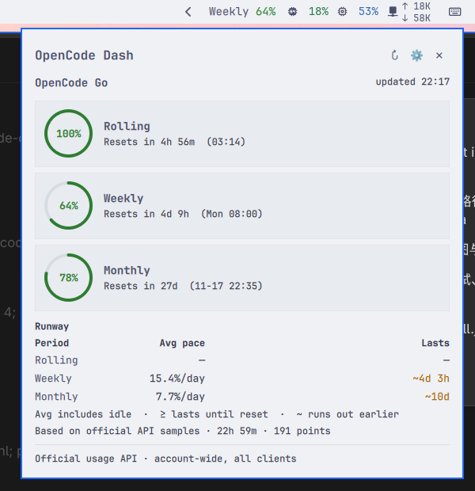

# OpenCode Quota

[English](#english) · [中文](#中文)

| Dark theme | Light theme |
|---|---|
|  |  |

## English

OpenCode Quota keeps your **OpenCode Go / Go Plus** subscription quota in the
Omarchy bar. By default it shows the window that is closest to its limit, and
one click opens reset countdowns, a runway estimate, local usage trends, and
per-model detail.

### Features

- Bar display: `worst` (least remaining), `all` windows, or `month` only.
- Remaining percentage by default; switch to used in the settings.
- Status colors: healthy green, remaining ≤ 20% amber, ≤ 10% red with `!`.
- Hover card: the percentage itself is colored (window labels stay in the foreground), with reset countdowns, runway, and local usage.
- Panel: three quota windows, reset times and countdowns, runway, 7-day/cycle
  trend, per-model usage, and an inline settings page.
- Threshold notifications through `notify-send`, deduplicated per window,
  level, and reset time.
- OpenCode v2 credentials from `opencode.db`; v1 `auth.json` fallback.
- Light and dark themes; top, bottom, left, and right bars.
- No key storage, no telemetry, read-only database access.

### Requirements

- Omarchy Quattro 4.x (tested on 4.0.6).
- Python 3.10 or newer (standard library only).
- `notify-send` from libnotify, for notifications (optional).
- OpenCode signed in to OpenCode Go or Go Plus.

### Install

```bash
omarchy plugin add https://github.com/jihonghe/opencode-quota --enable
omarchy restart shell
```

If the widget is installed but not in the bar yet:

```bash
omarchy plugin enable jihonghe.opencode-quota
```

Move it with `omarchy bar move jihonghe.opencode-quota --section right`, or
drag it in the bar. Update and remove with:

```bash
omarchy plugin update jihonghe.opencode-quota
omarchy plugin remove jihonghe.opencode-quota
```

### Configuration

Settings live inline in `~/.config/omarchy/shell.json` under this widget's
layout entry. The panel's settings page and **Setup → Plugins** edit the same
fields.

| Key | Type | Default | Description |
|---|---|---|---|
| `refreshIntervalSec` | integer | `300` | Refresh interval, 60–3600 seconds |
| `barWindows` | enum | `worst` | `worst`, `all`, or `month` |
| `percentMode` | enum | `remaining` | `remaining` or `used` |
| `warnRemaining` | integer | `20` | Warn below this remaining percentage |
| `critRemaining` | integer | `10` | Critical below this remaining percentage |
| `notifyEnabled` | boolean | `true` | Threshold notifications |
| `notifyReset` | boolean | `false` | Notify when a window starts over |
| `showModelDetail` | boolean | `true` | Show per-model usage in the panel |
| `renewOverride` | string | `""` | ISO 8601 renewal time, used only when the API fails |
| `planLabel` | string | `OpenCode Go` | Label shown in the panel and notifications |

The bar text uses short labels: `5h` (rolling), `7d` (weekly), and `M`
(subscription month). In a vertical bar the widget shows the worst window as
two lines (`7d` / `79%`) to stay readable.

### Data sources and privacy

- Quota percentages come from
  `GET https://opencode.ai/zen/go/v1/usage` with a Bearer token. This endpoint
  is official but not documented; other OpenCode tools use it as well.
- The key is read from the v2 `credential` table in
  `~/.local/share/opencode/opencode.db` (`integration_id = 'opencode-go'`), with
  `~/.local/share/opencode/auth.json` as the v1 fallback.
- The key is kept in memory only. It is never written to a file, cache, log,
  command line, or error message. The only host that receives it is
  `opencode.ai`.
- The database is opened with `mode=ro`; only `credential`,
  `session_message`, and `message` are read. OpenCode data is never modified.
- Local model detail covers the `opencode-go` and `opencode` providers (the
  latter is where free models such as nemotron appear). Local costs are shown
  for information only and are **not** converted into quota percentages.
- Cache files live in `~/.cache/opencode-quota/` and contain percentages,
  timestamps, and local usage only. Samples are kept for 30 days.
- Standard `https_proxy` / `HTTPS_PROXY` environment variables are honored;
  no proxy is configured by the plugin itself.
- No telemetry and no other network destinations.

### How it works

`BarWidget.qml` periodically runs `python3 scripts/quota.py --json`. The
script reads the key, calls the usage endpoint, aggregates local per-model and
per-day usage from `opencode.db`, appends a sample, computes runway, and
returns one JSON document. QML only renders it. A 60-second cache and a file
lock keep multiple bar instances from duplicating API calls; manual refresh
(`middle click`, the panel button, or `r` in the panel) bypasses the cache.
Notifications are sent with `notify-send`; no systemd unit is installed.

### Troubleshooting

- **Bar shows `—`**: no credentials, or the sign-in expired. Run OpenCode and
  sign in to OpenCode Go.
- **Values look stale**: the API is unreachable; the last successful reading
  is shown dimmed. The panel footer says when it was cached.
- **No notifications**: check `notify-send`, your notification daemon, and
  Do Not Disturb. Alerts are deduplicated per window/level/reset.
- **Check the data layer manually**:
  `python3 scripts/quota.py --json --force | python3 -m json.tool`
- **Logs**: `journalctl --user -b --no-pager | grep -i opencode-quota`
- After installing or updating, run `omarchy restart shell` once.

### Development

```bash
# Link the working tree instead of cloning
ln -sfn "$PWD" ~/.config/omarchy/plugins/jihonghe.opencode-quota
omarchy-shell shell rescanPlugins
omarchy plugin enable jihonghe.opencode-quota

# Tests (no network or real key required)
python3 -m unittest discover -s tests -v
tests/run-model-test.sh

# Manifest check
omarchy plugin validate .
```

For UI state tests, add `"debugFixture": "/path/to/tests/fixtures/report-stale.json"`
to the widget's `shell.json` entry. The script then returns that fixture
instead of real data. This hidden development setting is not part of the
manifest schema; remove it when done.

### Credits and license

- Settings persistence follows the pattern from
  [crmne/omastats](https://github.com/crmne/omastats) (MIT).
- Endpoint behavior and UX were informed by
  [slkiser/opencode-quota](https://github.com/slkiser/opencode-quota),
  [mryll/claudebar](https://github.com/mryll/claudebar), and
  [othavi0/omarchy-agent-bar](https://github.com/othavi0/omarchy-agent-bar).
- Licensed under the MIT License; see [LICENSE](LICENSE).

---

## 中文

OpenCode Quota 把 **OpenCode Go / Go Plus** 的订阅额度放进 Omarchy 顶栏。默认只显示
剩余最少、最接近上限的那个窗口；点开面板可以看到三个窗口、重置倒计时、runway
估算、本地用量趋势和按模型明细。

### 功能

- 顶栏显示：`worst`（剩余最少）、`all`（三个窗口）、`month`（只看订阅月）。
- 默认显示剩余百分比，可在设置里切换为已用。
- 状态颜色：健康绿色，剩余 ≤ 20% 琥珀色，≤ 10% 红色并带 `!`。
- hover 卡片：百分比本身按状态着色（窗口标签保持前景色），并显示重置倒计时、runway 和本地用量。
- 面板：三个额度窗口、重置时间和倒计时、runway、7 天/本周期趋势、按模型用量、
  面板内设置页。
- 阈值通知由 `notify-send` 发送；按“窗口 + 级别 + 重置时间”去重。
- 支持 OpenCode v2（`opencode.db` 的 credential 表）和 v1（`auth.json`）凭据。
- 明暗主题、top/bottom/left/right 四个方向的顶栏。
- 不保存 key、无遥测、数据库只读。

### 依赖

- Omarchy Quattro 4.x（在 4.0.6 上测试）。
- Python 3.10+（只用标准库）。
- `notify-send`（libnotify），用于通知，可选。
- OpenCode 已登录 OpenCode Go 或 Go Plus。

### 安装

```bash
omarchy plugin add https://github.com/jihonghe/opencode-quota --enable
omarchy restart shell
```

如果插件已安装但没出现在顶栏：

```bash
omarchy plugin enable jihonghe.opencode-quota
```

用 `omarchy bar move jihonghe.opencode-quota --section right` 移动位置，或在顶栏上
直接拖动。更新和卸载：

```bash
omarchy plugin update jihonghe.opencode-quota
omarchy plugin remove jihonghe.opencode-quota
```

### 配置

设置保存在 `~/.config/omarchy/shell.json` 中本 widget 的 layout entry 里。面板设置页
和 **Setup → Plugins** 修改的是同一份字段。

| 键 | 类型 | 默认 | 说明 |
|---|---|---|---|
| `refreshIntervalSec` | integer | `300` | 刷新间隔，60–3600 秒 |
| `barWindows` | enum | `worst` | `worst` / `all` / `month` |
| `percentMode` | enum | `remaining` | `remaining` / `used` |
| `warnRemaining` | integer | `20` | 剩余低于此百分比时警告 |
| `critRemaining` | integer | `10` | 剩余低于此百分比时严重警告 |
| `notifyEnabled` | boolean | `true` | 阈值通知 |
| `notifyReset` | boolean | `false` | 窗口重置时通知 |
| `showModelDetail` | boolean | `true` | 面板显示按模型用量 |
| `renewOverride` | string | `""` | ISO 8601 续订时间，仅 API 失败时兜底 |
| `planLabel` | string | `OpenCode Go` | 面板和通知里的套餐标签 |

顶栏短标签：`5h`（滚动窗口）、`7d`（自然周）、`M`（订阅月）。垂直顶栏只显示
最紧窗口，分两行显示（`7d` / `79%`），避免文字被截断。

### 数据源与隐私

- 额度百分比来自 `GET https://opencode.ai/zen/go/v1/usage`，使用 Bearer token。
  该端点是官方的但未文档化，其他 OpenCode 工具也在使用。
- key 优先从 `~/.local/share/opencode/opencode.db` 的 v2 `credential` 表读取
  （`integration_id = 'opencode-go'`），回退到
  `~/.local/share/opencode/auth.json`（v1）。
- key 只在内存中使用：不写文件、不写缓存、不写日志、不进命令行、不进错误信息。
  唯一接收 key 的地址是 `opencode.ai`。
- 数据库以 `mode=ro` 只读打开，只读取 `credential`、`session_message` 和
  `message`，不修改 OpenCode 的任何数据。
- 本地模型明细覆盖 `opencode-go` 和 `opencode` 两个 provider（免费模型如 nemotron
  属于后者）。本地 cost 只用于展示，**不换算成配额百分比**。
- 缓存位于 `~/.cache/opencode-quota/`，只包含百分比、时间和本地用量；采样保留
  30 天。
- 尊重标准 `https_proxy` / `HTTPS_PROXY` 环境变量；插件本身不硬编码代理。
- 无遥测，不访问其他网络地址。

### 工作原理

`BarWidget.qml` 定时运行 `python3 scripts/quota.py --json`。脚本读取 key、调用额度
端点、从 `opencode.db` 聚合按模型和按天的本地用量、写入采样、计算 runway，最后
输出一份 JSON；QML 只负责渲染。60 秒缓存和文件锁避免多显示器重复请求；手动刷新
（中键、面板按钮或面板内按 `r`）会绕过缓存。通知直接调用 `notify-send`，不安装
systemd 单元。

### 排障

- **顶栏显示 `—`**：没有凭据或登录已过期。运行 OpenCode 并重新登录 OpenCode Go。
- **数值看起来是旧的**：API 不可达，显示上次成功读数并变暗；面板底部会标注缓存
  时间。
- **没有通知**：检查 `notify-send`、通知守护进程和勿扰模式。通知按窗口/级别/
  重置时间去重。
- **手动检查数据层**：
  `python3 scripts/quota.py --json --force | python3 -m json.tool`
- **日志**：`journalctl --user -b --no-pager | grep -i opencode-quota`
- 安装或更新后执行一次 `omarchy restart shell`。

### 开发

```bash
# 用软链代替 clone
ln -sfn "$PWD" ~/.config/omarchy/plugins/jihonghe.opencode-quota
omarchy-shell shell rescanPlugins
omarchy plugin enable jihonghe.opencode-quota

# 测试（不需要网络或真实 key）
python3 -m unittest discover -s tests -v
tests/run-model-test.sh

# manifest 校验
omarchy plugin validate .
```

调试界面状态时，可以在 widget 的 `shell.json` entry 里加
`"debugFixture": "/path/to/tests/fixtures/report-stale.json"`，脚本会直接返回该
fixture。这个隐藏的开发字段不在 manifest schema 里，用完请删除。

### 致谢与许可

- 设置持久化参考了 [crmne/omastats](https://github.com/crmne/omastats)（MIT）。
- 端点行为和交互参考了
  [slkiser/opencode-quota](https://github.com/slkiser/opencode-quota)、
  [mryll/claudebar](https://github.com/mryll/claudebar)、
  [othavi0/omarchy-agent-bar](https://github.com/othavi0/omarchy-agent-bar)。
- MIT License，见 [LICENSE](LICENSE)。
